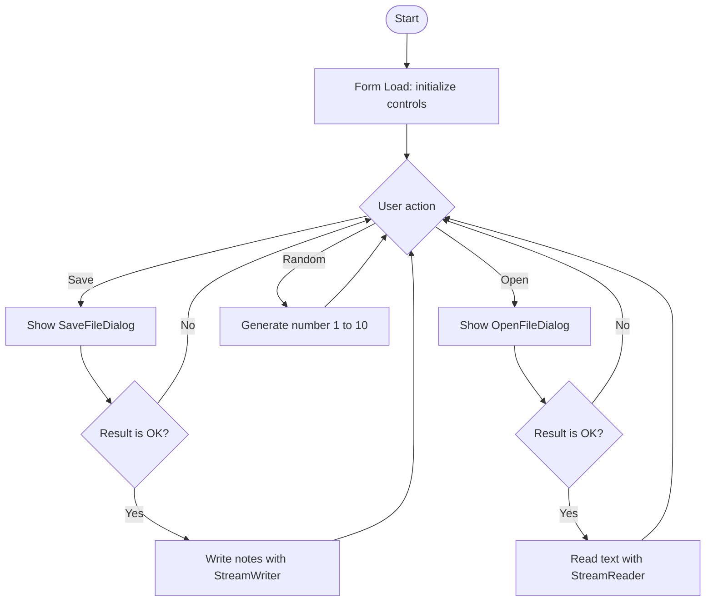

# Week Five Practical Example — Class Notes File Manager

**Chapter topics:** Files, StreamWriter, StreamReader, OpenFileDialog, SaveFileDialog, Random, and Form Load event.  
**Application:** Windows Forms

## 1. Project idea

Create a small application that lets a user type class notes, save them to a text file, open an existing text file, and generate a random practice number.

Mashruucan wuxuu isku keenayaa casharrada Week Five: file writing, file reading, dialogs, random numbers, iyo Form Load event.

## 2. Windows Forms controls and components

| Control / Component | Name | Text / Purpose |
|---|---|---|
| TextBox (Multiline = true) | `txtNotes` | Enter notes |
| Button | `btnSave` | Save Notes |
| Button | `btnOpen` | Open Notes |
| Button | `btnRandom` | Generate Number |
| Label | `lblRandomNumber` | Random number appears here |
| SaveFileDialog | `saveFileDialog1` | Choose save location |
| OpenFileDialog | `openFileDialog1` | Choose a file |

Add the two dialog components from the Visual Studio Toolbox. Set `txtNotes.Multiline = true` in Properties.

## 3. Required namespace

At the top of the form code, make sure you have:

```csharp
using System;
using System.IO;
using System.Windows.Forms;
```

## 4. Save notes — StreamWriter and SaveFileDialog

```csharp
private void btnSave_Click(object sender, EventArgs e)
{
    if (string.IsNullOrWhiteSpace(txtNotes.Text))
    {
        MessageBox.Show("Please enter some notes first.");
        return;
    }

    if (saveFileDialog1.ShowDialog() == DialogResult.OK)
    {
        using (StreamWriter outputFile =
               File.CreateText(saveFileDialog1.FileName))
        {
            outputFile.WriteLine(txtNotes.Text);
        }

        MessageBox.Show("Notes saved successfully!");
    }
}
```

### Explanation

- `ShowDialog()` opens the Save As dialog.
- `DialogResult.OK` means the user selected a location and confirmed.
- `File.CreateText()` creates a text file or replaces its existing contents.
- `WriteLine()` writes the notes and adds a line break.
- `using` closes the writer automatically when the block ends.

**Important:** `CreateText()` overwrites an existing file. If you want to add text to the end of an existing file, the chapter's `File.AppendText()` method is the relevant alternative.

## 5. Open notes — StreamReader and OpenFileDialog

```csharp
private void btnOpen_Click(object sender, EventArgs e)
{
    if (openFileDialog1.ShowDialog() == DialogResult.OK)
    {
        using (StreamReader inputFile =
               File.OpenText(openFileDialog1.FileName))
        {
            txtNotes.Text = inputFile.ReadToEnd();
        }

        MessageBox.Show("File opened successfully!");
    }
}
```

### Explanation

- `OpenFileDialog` lets the user choose a file.
- The program reads the file only if the result is `DialogResult.OK`.
- `File.OpenText()` opens the selected text file.
- `ReadToEnd()` reads all remaining text.
- The text is placed inside `txtNotes`.

## 6. Generate a random number

```csharp
private void btnRandom_Click(object sender, EventArgs e)
{
    Random random = new Random();

    int number = random.Next(1, 11);

    lblRandomNumber.Text = number.ToString();
}
```

`Next(1, 11)` can return 1 through 10. The lower bound is included and the upper bound is excluded.

## 7. Form Load event

Use the form's Load event to prepare the application before the user starts using it.

```csharp
private void Form1_Load(object sender, EventArgs e)
{
    txtNotes.Clear();
    lblRandomNumber.Text = "No number yet";
}
```

In Visual Studio, select the form, open the Properties window, choose the Events (lightning bolt) icon, and connect the Load event to `Form1_Load`. Alternatively, double-click the form background in the Designer.

## 8. Expected behavior

| User action | Expected result |
|---|---|
| Click Save Notes | Save dialog appears; notes are saved after OK |
| Click Open Notes | Open dialog appears; selected text appears in the TextBox |
| Click Generate Number | A number from 1 to 10 appears |
| Cancel either dialog | No file operation is performed |
| Open the form | Initial controls are prepared |

## 9. Flowchart



## 10. Practice exercises

1. Change the random number range to 1 through 6 (a dice).
2. Add a button that appends a new line to a file using `File.AppendText()`.
3. Use `ReadLine()` to read only the first line of a selected file.
4. Explain the difference between `Write()` and `WriteLine()`.
5. What is the difference between `DialogResult.OK` and `DialogResult.Cancel`?
6. Set the Open dialog's `InitialDirectory` to a folder on your computer.
7. Explain why `using` is useful with StreamReader and StreamWriter.

### Challenge

Add a second random-number button that generates a number from 1 to 100. Display both generated values in separate labels.

## 11. Screenshot checklist

Capture your own screenshots showing:
- Form design and Toolbox controls.
- Save dialog and a successful save.
- Open dialog and loaded notes.
- Random number output.
- Form after its Load event initializes the controls.

Save them in `weekFive/Example/screenshots/`.

**Reminder:** Use a real file path selected through the dialog; do not assume another computer has the same path.