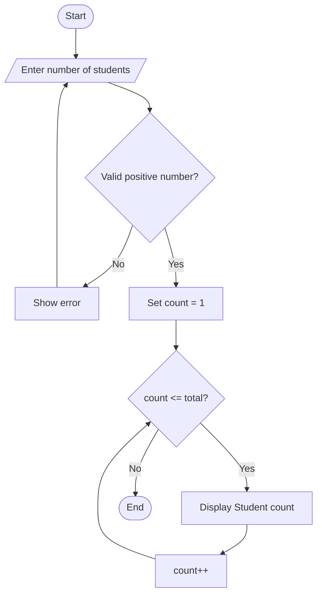

# Week Four Practical Example — Student Attendance Counter

**Chapter topic:** Loops in C#  
**Application:** Windows Forms  
**Purpose:** Practice `while`, `for`, `do-while`, increment and decrement operators.

## 1. Project idea

Build a small **Student Attendance Counter**. The user enters how many students are in a class. The application uses a loop to count from 1 to that number and displays the result. A second button demonstrates a countdown using a `for` loop.

Mashruucan wuxuu ku barayaa sida loop loogu celceliyo amarro, sida counter loo kordhiyo, iyo sida loo joojiyo loop-ka marka condition-ku false noqdo.

## 2. Windows Forms controls

| Control | Name | Text |
|---|---|---|
| Label | `lblStudentCount` | Number of students: |
| TextBox | `txtStudentCount` | |
| Button | `btnCountStudents` | Count Students |
| Button | `btnCountdown` | Countdown |
| ListBox | `lstResults` | |

## 3. Code

Add this code inside your form class. Connect each button to its Click event.

### Count students — while loop

```csharp
private void btnCountStudents_Click(object sender, EventArgs e)
{
    int totalStudents;

    if (!int.TryParse(txtStudentCount.Text, out totalStudents) ||
        totalStudents <= 0)
    {
        MessageBox.Show("Enter a valid positive number.");
        return;
    }

    lstResults.Items.Clear();

    int count = 1;

    while (count <= totalStudents)
    {
        lstResults.Items.Add("Student " + count);
        count++;
    }

    MessageBox.Show("Counting completed!");
}
```

### Countdown — for loop

```csharp
private void btnCountdown_Click(object sender, EventArgs e)
{
    lstResults.Items.Clear();

    for (int number = 10; number >= 1; number--)
    {
        lstResults.Items.Add(number);
    }

    lstResults.Items.Add("Start!");
}
```

## 4. Code explanation | Sharaxaad

- `int.TryParse()` checks whether the TextBox contains a valid integer.
- `count = 1` starts the counter at 1.
- `while (count <= totalStudents)` repeats while the count is not greater than the entered total.
- `count++` increases the counter by one. Without it, the loop could become infinite.
- In the countdown, `number--` decreases the value by one after each repetition.
- `lstResults.Items.Clear()` removes old results before showing new ones.

## 5. Expected output

If the user enters `4` and clicks **Count Students**:

```text
Student 1
Student 2
Student 3
Student 4
```

If the user clicks **Countdown**:

```text
10
9
8
7
6
5
4
3
2
1
Start!
```

## 6. Loop comparison

| Loop | When condition is checked | Minimum executions |
|---|---|---:|
| `while` | Before the body | 0 |
| `for` | Before the body | 0 |
| `do-while` | After the body | 1 |

Example of a `do-while` loop:

```csharp
int value = 5;

do
{
    MessageBox.Show(value.ToString());
} while (value < 0);
```

The message appears once because `do-while` checks its condition after executing the body.

## 7. Flowchart



## 8. Practice exercises

1. Change the `while` loop so it counts from 1 to 20.
2. Use a `for` loop to display even numbers from 2 to 20.
3. Use a `for` loop to count backwards from 20 to 1.
4. Write a `do-while` loop that displays a message at least once.
5. Explain what happens if you remove `count++` from the first loop.
6. Change the application so the user enters the countdown starting number.

### Challenge

Add a third button named `btnSumNumbers`. Ask the user for a positive number and calculate the sum from 1 up to that number using a loop.

## 9. Screenshot checklist

After building the form in Visual Studio, capture:
- Form design showing all controls and their names in Properties.
- Successful student count output.
- Countdown output.
- Validation message for invalid input.

Save screenshots in a folder named `screenshots` inside this Example folder.

**Reminder:** The screenshots should come from your own running Visual Studio project.