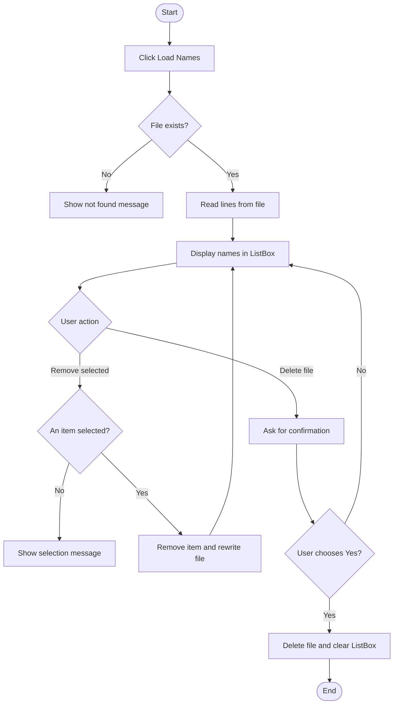

# Week Six Practical Example — Student Names File Manager

**Chapter topic:** File handling in C#  
**Application:** Windows Forms  
**Main methods:** `StreamReader`, `File.OpenText()`, `File.ReadAllLines()`, `File.ReadLines()`, `File.Exists()`, `File.WriteAllLines()`, and `File.Delete()`.

## 1. Project idea

Build a Student Names File Manager. The user can load names from a text file, display them in a ListBox, remove a selected name, and delete the entire file after confirmation.

Mashruucan wuxuu ku tababariyaa akhrinta file, hubinta inuu jiro, ka saarista hal item, iyo tirtirista file dhan.

## 2. Windows Forms controls

| Control | Name | Text |
|---|---|---|
| ListBox | `lstNames` | |
| Button | `btnLoad` | Load Names |
| Button | `btnRemove` | Remove Selected |
| Button | `btnDeleteFile` | Delete Entire File |
| Button | `btnReadAllLines` | Read All Lines |
| Label | `lblStatus` | Status |

For this practice example, use a text file named `students.txt` in the application's working folder.

## 3. Add the namespace and file path

```csharp
using System;
using System.IO;
using System.Windows.Forms;

private string filePath = "students.txt";
```

The file path is relative to the application's working directory. For a beginner project, you can also use a full path to a folder that exists on your own computer.

## 4. Check whether the file exists

```csharp
private void btnLoad_Click(object sender, EventArgs e)
{
    lstNames.Items.Clear();

    if (!File.Exists(filePath))
    {
        MessageBox.Show("The students file was not found.");
        return;
    }

    using (StreamReader inputFile = File.OpenText(filePath))
    {
        while (!inputFile.EndOfStream)
        {
            string line = inputFile.ReadLine();
            lstNames.Items.Add(line);
        }
    }

    lblStatus.Text = "Names loaded successfully.";
}
```

### Explanation

- `File.Exists()` checks whether the file exists.
- `File.OpenText()` opens a text file for reading.
- `EndOfStream` becomes true when the end of the file is reached.
- `ReadLine()` reads one line at a time.
- `Items.Add()` adds each name to the ListBox.
- `using` ensures the reader is closed after use.

## 5. Read all lines using File.ReadAllLines()

This alternative reads every line and returns a string array.

```csharp
private void btnReadAllLines_Click(object sender, EventArgs e)
{
    if (!File.Exists(filePath))
    {
        MessageBox.Show("The students file was not found.");
        return;
    }

    string[] names = File.ReadAllLines(filePath);

    lstNames.Items.Clear();
    lstNames.Items.AddRange(names);

    lblStatus.Text = "All lines loaded.";
}
```

The chapter also introduces `File.ReadLines()`, which returns a sequence of lines that can be processed with `foreach`:

```csharp
foreach (string name in File.ReadLines(filePath))
{
    MessageBox.Show(name);
}
```

## 6. Remove one selected name

```csharp
private void btnRemove_Click(object sender, EventArgs e)
{
    if (!File.Exists(filePath))
    {
        MessageBox.Show("The students file was not found.");
        return;
    }

    if (lstNames.SelectedIndex == -1)
    {
        MessageBox.Show("Please select a name first.");
        return;
    }

    string[] names = File.ReadAllLines(filePath);
    int selectedIndex = lstNames.SelectedIndex;

    var nameList = new System.Collections.Generic.List<string>(names);
    nameList.RemoveAt(selectedIndex);

    File.WriteAllLines(filePath, nameList);

    lstNames.Items.Clear();
    lstNames.Items.AddRange(nameList.ToArray());

    lblStatus.Text = "Selected name removed.";
}
```

### Explanation

1. Check that the file exists.
2. Check that the user selected an item.
3. Read the file into an array.
4. Use the selected ListBox index to identify the matching line.
5. Remove that line from the list.
6. Write the remaining names back to the file.
7. Refresh the ListBox.

**Important:** This example assumes the ListBox is loaded directly from the file and its order has not been changed. If the displayed list is sorted or filtered, the selected index may no longer match the original file line.

## 7. Delete the entire file safely

```csharp
private void btnDeleteFile_Click(object sender, EventArgs e)
{
    if (!File.Exists(filePath))
    {
        MessageBox.Show("The file does not exist.");
        return;
    }

    DialogResult answer = MessageBox.Show(
        "Are you sure you want to delete the entire file?",
        "Confirm Delete",
        MessageBoxButtons.YesNo,
        MessageBoxIcon.Warning);

    if (answer == DialogResult.Yes)
    {
        File.Delete(filePath);
        lstNames.Items.Clear();
        lblStatus.Text = "File deleted.";
    }
}
```

- `MessageBox.Show()` asks the user to confirm.
- `DialogResult.Yes` means the user agreed.
- `File.Delete()` deletes the file.
- The ListBox is cleared after deletion.

**Warning:** Deleting the file removes the whole file, not just one name. Only test this with a practice file that you can recreate.

## 8. Example text file

Create `students.txt` with these lines:

```text
Amina
Hassan
Maryan
Ahmed
```

After clicking **Load Names**, the ListBox should show:

```text
Amina
Hassan
Maryan
Ahmed
```

If the user selects `Maryan` and clicks **Remove Selected**, the file should contain:

```text
Amina
Hassan
Ahmed
```

## 9. Flowchart



## 10. Practice exercises

1. Add two more names to `students.txt` and load them.
2. Explain the difference between `ReadAllLines()` and `ReadLines()`.
3. What does `File.Exists()` return when the file is missing?
4. What happens if the user clicks Remove Selected without selecting a name?
5. Change the confirmation message before deleting the file.
6. Add a button that displays the number of names in the ListBox.
7. Explain the difference between deleting one selected line and deleting the entire file.

### Challenge

Add a TextBox and an **Add Name** button. When the user enters a name, append it to the file with `File.AppendAllText()` or `File.AppendText()`, then refresh the ListBox. Validate that the TextBox is not empty.

## 11. Screenshot checklist

Capture your own screenshots showing:
- Form design with ListBox and buttons.
- Names loaded from the text file.
- A selected name before removal.
- List after removing one name.
- Confirmation dialog before deleting the entire file.
- Status after deletion.

Save screenshots in `weekSix/Example/screenshots/`.

**Reminder:** Use a separate practice file. Do not test deletion on important personal files.