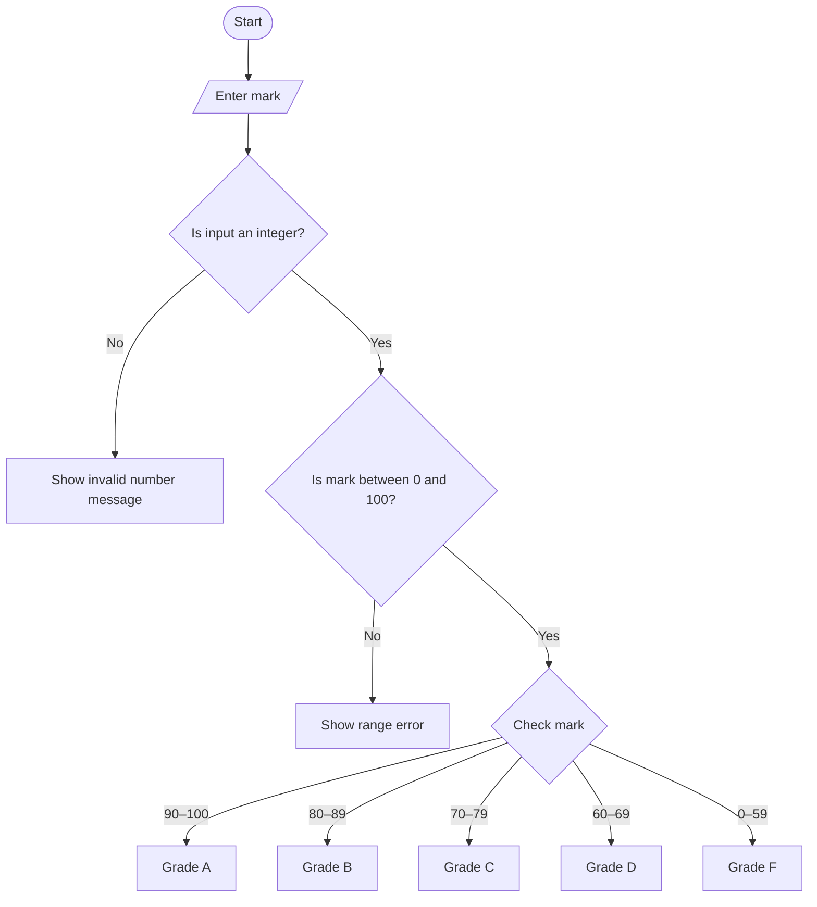

# 📘 Week Three — Making Decisions in C#

## 📌 Overview | Dulmarka

This folder contains my **Week Three C# practice** based on Chapter 4, **Making Decisions**, from *Starting Out with Visual C# (Sixth Edition)*.

Cutubkan wuxuu diiradda saarayaa sida program-ku go'aan u gaaro iyadoo la adeegsanayo conditions. Waxaan baranayaa sida C# loogu hubiyo xaalado kala duwan, loo xaqiijiyo user input, loona doorto waxa program-ku qabanayo iyadoo ku xiran xogta la geliyo.

## 🎯 Learning Objectives | Ujeeddooyinka

- Understand decision structures and the `if` statement.
- Use `if-else` and nested decision structures.
- Evaluate multiple conditions using logical operators.
- Work with `bool` variables and flags.
- Compare strings.
- Prevent conversion errors using `TryParse()`.
- Validate user input before processing it.
- Use `RadioButton`, `CheckBox`, `switch`, and `ListBox` controls.

## 🧠 Topics Covered | Mawduucyada La Bartay

### 1. Decision Structures and `if`

A decision structure runs statements only when a condition is true.

Decision structure waa hab uu program-ku ku hubiyo condition. Haddii condition-ku yahay `true`, statements-ka ku jira `if` ayaa la fulinayaa.

```csharp
if (score >= 50)
{
    MessageBox.Show("You passed!");
}
```

### 2. The `if-else` Statement

The `if-else` statement provides two possible paths: one when the condition is true and another when it is false.

Waxay program-ka u oggolaanaysaa inuu sameeyo hal action haddii shuruuddu sax tahay, iyo action kale haddii aysan sax ahayn.

```csharp
if (temperature > 40)
{
    MessageBox.Show("Hot");
}
else
{
    MessageBox.Show("Not hot");
}
```

### 3. Nested Decision Structures

Nested decisions mean placing one `if` or `if-else` statement inside another.

Waxaa la isticmaalaa marka go'aanka labaad uu ku xiran yahay natiijada go'aanka koowaad.

### 4. The `if-else-if` Statement

This structure checks several conditions in order until one condition is true.

Waxay faa'iido leedahay marka la kala saarayo grades ama xaalado badan, tusaale ahaan score A, B, C, D, ama F.

### 5. Logical Operators

Logical operators combine or reverse Boolean conditions.

- `&&` — AND: labada conditions waa inay true noqdaan.
- `||` — OR: ugu yaraan hal condition waa inuu true noqdaa.
- `!` — NOT: wuxuu beddelaa true una beddelaa false, ama lidkeeda.

### 6. `bool` Variables and Flags

A `bool` variable stores either `true` or `false`. A flag is used to indicate whether a condition exists.

`bool` waxaa loo adeegsadaa xaalado leh laba jawaabood, sida `true/false` ama `yes/no`.

### 7. Comparing Strings

Strings can be compared using `==`, `!=`, or `String.Compare()`.

Tani waxay caawisaa marka program-ku hubinayo in text-ka user-ku geliyey uu la mid yahay qoraal kale. Xusuusnow in `==` uu caadi ahaan kala saaro uppercase iyo lowercase.

### 8. Preventing Conversion Exceptions with `TryParse()`

Methods such as `int.TryParse()`, `double.TryParse()`, and `decimal.TryParse()` attempt to convert input without throwing a conversion exception when the input is invalid.

Marka user-ku TextBox geliyo xog, `TryParse()` wuxuu hubiyaa in xogta loo beddeli karo number. Waxaa la isticmaalaa `out` si loo helo natiijada conversion-ka.

```csharp
int age;

if (int.TryParse(txtAge.Text, out age))
{
    MessageBox.Show("Valid number");
}
else
{
    MessageBox.Show("Please enter a valid age");
}
```

### 9. Input Validation

Input validation checks whether entered data is acceptable before the program uses it.

`TryParse()` wuxuu hubiyaa in xogtu number noqon karto, laakiin keligiis ma xaqiijiyo in number-ku macquul yahay. Tusaale ahaan, score waa inuu u dhexeeyaa 0 iyo 100.

```csharp
if (score >= 0 && score <= 100)
{
    // The score is within the valid range.
}
```

### 10. Radio Buttons and Check Boxes

- **RadioButton:** usually allows the user to select one option from a group.
- **CheckBox:** allows the user to turn an option on or off; multiple check boxes can be selected.

Property-ga `Checked` ayaa lagu hubiyaa in control-ka la doortay. `CheckedChanged` event ayaa dhaca marka xaaladda `Checked` is beddesho.

### 11. The `switch` Statement

The `switch` statement chooses a path based on the value of an expression. It can be an alternative to an `if-else-if` structure when comparing one value against several options.

`case` kasta wuxuu matalaa value gaar ah, `break` ayaa joojiya case-ka, halka `default` uu qabto xaaladda aan la helin case ku habboon.

```csharp
switch (month)
{
    case 1:
        MessageBox.Show("January");
        break;
    case 2:
        MessageBox.Show("February");
        break;
    default:
        MessageBox.Show("Invalid month");
        break;
}
```

### 12. Introduction to `ListBox`

A `ListBox` displays a list of items and can let users select an item.

Properties and methods to remember:

- `Items.Add()` — adds an item.
- `Items.Count` — returns the number of items.
- `SelectedItem` — gets the selected item.
- `SelectedIndex` — gives the selected item's zero-based index; `-1` means no item is selected.
- `Items.Remove()` — removes a specific item.
- `Items.RemoveAt()` — removes an item by index.
- `Items.Clear()` — removes all items.

Waxaa muhiim ah in la hubiyo in item la doortay ka hor inta aan la isticmaalin `SelectedItem`, si looga fogaado errors.

## 🛠️ Technologies and Controls

- **Language:** C#
- **IDE:** Microsoft Visual Studio
- **Application Type:** Windows Forms
- **Controls:** `TextBox`, `Label`, `MessageBox`, `RadioButton`, `CheckBox`, `ListBox`
- **Main concepts:** conditions, Boolean expressions, input validation, selection controls

## 🎓 Learning Outcome | Waxa Aan Bartay

By studying this chapter, I am learning how to control program flow, compare values, validate input, and respond to user choices in C#.

Waxaan baranayaa sida loo qoro conditions sax ah, loo isticmaalo logical operators, looga hortago input conversion errors, loona dhiso Windows Forms applications go'aanno qaadan kara.

---

**Course:** C# Programming I  
**Section:** Week Three — Making Decisions  
**Reference:** *Starting Out with Visual C#, Sixth Edition*, Chapter 4  
**Purpose:** Study notes and practice


---

## 💻 Practical Example — Student Grade Checker

Tusaalahan waa **Windows Forms application** yar oo user-ku ku gelinayo marks-ka ardayga. Program-ku wuxuu hubinayaa in marks-ku sax yihiin, kadibna wuxuu soo bandhigayaa grade-ka.

### 🖼️ Application Design

Visual Studio Designer-ka ku samee Form leh controls-kan:

| Control | Name | Text |
|---|---|---|
| Label | `lblPrompt` | Enter Mark (0–100): |
| TextBox | `txtMark` | *(empty)* |
| Button | `btnCheckGrade` | Check Grade |
| Label | `lblResult` | *(empty)* |

**Fiiro gaar ah:** `Name`-ka controls-ka waa inuu la mid noqdaa kan code-ka ku qoran.

### 🧩 Code Example — Button Click Event

Double-click garee button-ka **Check Grade**, kadib geli code-kan gudaha `btnCheckGrade_Click`:

```csharp
private void btnCheckGrade_Click(object sender, EventArgs e)
{
    int mark;

    // Check whether the input is a valid integer.
    if (!int.TryParse(txtMark.Text, out mark))
    {
        MessageBox.Show("Please enter a valid whole number.");
        txtMark.Focus();
        return;
    }

    // Check whether the mark is within the valid range.
    if (mark < 0 || mark > 100)
    {
        MessageBox.Show("Mark must be between 0 and 100.");
        txtMark.Focus();
        return;
    }

    // Decide the grade.
    if (mark >= 90)
    {
        lblResult.Text = "Grade: A";
    }
    else if (mark >= 80)
    {
        lblResult.Text = "Grade: B";
    }
    else if (mark >= 70)
    {
        lblResult.Text = "Grade: C";
    }
    else if (mark >= 60)
    {
        lblResult.Text = "Grade: D";
    }
    else
    {
        lblResult.Text = "Grade: F — Try again";
    }
}
```

### 🔍 Code Explanation | Sharaxaadda Code-ka

1. `int mark;` — wuxuu diyaarinayaa variable lagu kaydiyo marks-ka.
2. `int.TryParse()` — wuxuu hubiyaa in input-ku yahay integer; haddii kale, error message ayuu muujinayaa.
3. `mark < 0 || mark > 100` — wuxuu diidayaa marks ka baxsan 0 ilaa 100.
4. `return;` — wuxuu joojinayaa method-ka marka input-ku khaldan yahay.
5. `if / else if / else` — wuxuu dooranayaa grade-ka ku habboon.
6. `lblResult.Text` — wuxuu natiijada ku soo bandhigayaa Label-ka.

### 📊 Expected Output | Natiijada La Filayo

| Input Mark | Result |
|---:|---|
| `95` | Grade: A |
| `84` | Grade: B |
| `73` | Grade: C |
| `65` | Grade: D |
| `42` | Grade: F — Try again |
| `hello` | Message: Please enter a valid whole number. |
| `120` | Message: Mark must be between 0 and 100. |

### 🔀 Decision Flowchart



## 📝 Practice Exercises | Layliyo

Isku day layliyadan adigoon marka hore ka raadin jawaabta. Waxay kaa caawinayaan inaad fahanto decision structures.

### Practice 1 — Pass or Fail
- User-ku ha geliyo mark 0–100.
- Haddii mark-ku yahay 50 ama ka badan, muuji **Passed**.
- Haddii uu ka hooseeyo 50, muuji **Failed**.
- Hubi in input-ku yahay number sax ah oo u dhexeeya 0 iyo 100.

### Practice 2 — Positive, Negative, or Zero
- Samee TextBox iyo Button.
- User-ku ha geliyo integer.
- Isticmaal `if / else if / else` si aad u muujiso inuu yahay **Positive**, **Negative**, ama **Zero**.
- Isticmaal `int.TryParse()` si looga hortago input khaldan.

### Practice 3 — Login Check
- Samee TextBox la yiraahdo `txtPassword` iyo Button.
- Haddii password-ku la mid yahay `"CSharp123"`, muuji **Login successful**.
- Haddii kale, muuji **Incorrect password**.
- Isku day inaad isticmaasho string comparison.

### Practice 4 — Switch Statement
- User-ku ha geliyo number u dhexeeya 1 iyo 7.
- Isticmaal `switch` si aad u muujiso maalinta usbuuca.
- Haddii number-ku aanu u dhexayn 1–7, muuji **Invalid day number**.

### ⭐ Challenge — Scholarship Eligibility
Samee program hubiya:
- Mark-ku waa inuu noqdaa 0–100.
- Haddii mark-ku yahay 90 ama ka badan **iyo** attendance-ku yahay 85 ama ka badan, muuji **Eligible for Scholarship**.
- Haddii kale, muuji **Not Eligible**.
- Adeegso logical operator-ka `&&` iyo input validation.

> **Rule:** Marka hore adigu isku day. Haddii aad ku xannibanto, soo dir code-kaaga ama screenshot-ka Visual Studio, waxaan kuu sheegi doonaa meesha khaladku yaallo anigoon isla markiiba kuu qaban dhammaan jawaabta.
